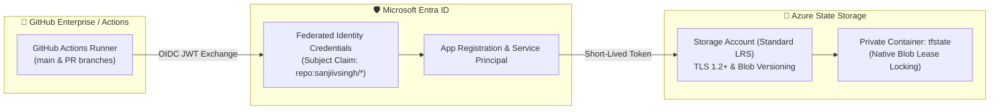

# 🚀 Azure Terraform Remote State & GitHub OIDC Bootstrap

[](https://www.terraform.io/)
[](https://registry.terraform.io/providers/hashicorp/azurerm/latest)
[](https://github.com/sanjiivsingh/azure-terraform-bootstrap-oidc/actions/workflows/ci.yml)
[-10B981?style=for-the-badge)](https://github.com/sanjiivsingh/azure-terraform-bootstrap-oidc)
[](https://opensource.org/licenses/MIT)

> **Reference Architecture · Statically Validated**  
> Foundational bootstrap blueprint for provisioning secure Azure remote state backends (Blob Storage with automated lease locking) and Microsoft Entra Workload Identity Federation (GitHub Actions passwordless OIDC authentication).

---

## 🎯 The Problem This Bootstrap Solves

1. **State File Exposure:** Committing `.tfstate` files locally or in git creates critical credential leaks and concurrency collisions.
2. **Secret Rotation Overhead:** Using long-lived Service Principal client secrets (`ARM_CLIENT_SECRET`) in GitHub Secrets introduces security exposure and expiration outages.
3. **Missing State Locks:** Concurrent team deployments without state locking cause silent state corruption.

**Solution:** This bootstrap provisions an isolated, versioned Azure Storage Account with blob lease locking, paired with passwordless GitHub OIDC federated identity credentials.

---

## 📐 Architecture Overview



---

## ⚙️ Quickstart Usage

### 1. Initialize & Review Plan
```bash
terraform init
terraform fmt -check
terraform validate
terraform plan -out=bootstrap.tfplan
```

### 2. Deploy
```bash
terraform apply bootstrap.tfplan
```

### 3. Consume in Downstream Repositories
Add the backend configuration block into your child landing zones (`provider.tf`):
```terraform
terraform {
  backend "azurerm" {
    resource_group_name  = "rg-terraform-bootstrap"
    storage_account_name = "<OUTPUT_STORAGE_ACCOUNT_NAME>"
    container_name       = "tfstate"
    key                  = "<project-name>/dev.terraform.tfstate"
    use_oidc             = true
  }
}
```

---

## 💰 Cost & Resource Teardown

* **Monthly Cost:** Minimal storage consumption (~$0.50 – $2.00 / month).
* **Teardown Notice:** Remote state storage holds active infrastructure maps. Before destroying the bootstrap storage account, ensure all downstream environments have been migrated or destroyed.

```bash
terraform destroy -auto-approve
```

---

## 👨‍💻 Author & Cloud Consultant

**Sanjeev Singh**  
*Freelance Azure Cloud Engineer | Terraform & Infrastructure Automation*  
* 🌐 **Portfolio**: [sanjeevsingh.oneps.in](https://sanjeevsingh.oneps.in)  
* 💼 **LinkedIn**: [linkedin.com/in/sanjiivsingh](https://linkedin.com/in/sanjiivsingh)  
* 🐙 **GitHub**: [github.com/sanjiivsingh](https://github.com/sanjiivsingh)

---

## 📄 License
Licensed under the [MIT License](LICENSE).

