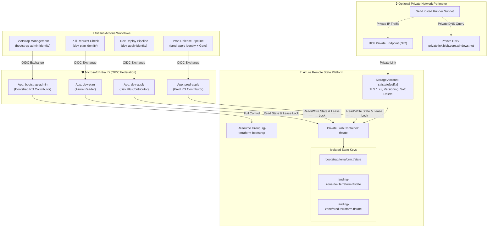
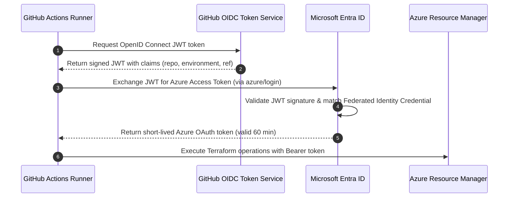

# 🚀 Azure Terraform Remote State & GitHub OIDC Bootstrap Platform

[](https://www.terraform.io/)
[](https://registry.terraform.io/providers/hashicorp/azurerm/latest)
[](https://github.com/sanjiivsingh/azure-terraform-bootstrap-oidc/actions/workflows/ci.yml)
[](https://github.com/sanjiivsingh/azure-terraform-bootstrap-oidc)
[](https://opensource.org/licenses/MIT)

> **Reference Architecture · Statically Validated**  
> Enterprise-grade, reusable foundation for Microsoft Azure Terraform deployments. Provisions secure remote state backends (Blob Storage with native lease locking, blob versioning, and soft delete) paired with passwordless Microsoft Entra Workload Identity Federation (GitHub Actions OIDC), environment-segregated RBAC, and optional private link perimeter hardening.

---

## 📌 Executive Summary

Managing Terraform state and pipeline credentials across enterprise teams requires solving three critical challenges:
1. **State Exposure & Corruption:** Committing `.tfstate` locally leaks secrets, while concurrent team runs without distributed locking corrupt state.
2. **Credential Rotation Overhead:** Storing static Service Principal client secrets (`ARM_CLIENT_SECRET`) in GitHub introduces secret leakage and expiration outages.
3. **Monolithic Blast Radii:** Sharing a single high-privilege identity across all repositories and environments allows speculative PR runs to mutate production infrastructure.

**The Solution:** This platform establishes an automated, passwordless, modular bootstrap environment providing:
- **Centralized Remote State:** Dedicated Azure Storage Account with TLS 1.2+, blob versioning, 30-day soft delete, and native blob lease locking.
- **Zero-Secret OIDC Federation:** Short-lived tokens minted on-demand using Microsoft Entra Workload Identity Federation.
- **Role-Segregated Identities:** Granular Entra applications for `bootstrap-admin`, `dev-plan`, `dev-apply`, `prod-plan`, and `prod-apply`.
- **Staged Network Isolation:** Clear roadmap to transition from initial public rollout over TLS 1.2+ to Private Endpoints and private DNS for self-hosted Azure runners.

---

## 🏛️ Target Architecture



---

## 🔐 OIDC Authentication Flow



---

## 📁 Repository Structure

```text
azure-terraform-bootstrap-oidc/
├── .github/
│   ├── CODEOWNERS
│   ├── dependabot.yml
│   └── workflows/
│       ├── ci.yml                     # Static code analysis, tflint, checkov, gitleaks
│       ├── terraform-plan.yml         # OIDC-authenticated plan generation & artifact publishing
│       ├── terraform-apply.yml        # Protected apply with GitHub Environment gates & concurrency
│       └── terraform-destroy.yml      # Manual dispatch with strict confirmation & state safeguards
│
├── environments/
│   └── bootstrap/                     # Dedicated environment composition
│       ├── main.tf                    # Environment module composition
│       ├── variables.tf               # Environment variables with type constraints & validations
│       ├── outputs.tf                 # Essential resource IDs, client IDs, and backend snippet
│       ├── providers.tf               # Provider constraints (azurerm, azuread, random)
│       ├── backend.tf                 # Remote backend config & state migration instructions
│       └── terraform.tfvars.example   # Sample configuration variables
│
├── modules/
│   ├── resource-group/                # Baseline Azure Resource Group module
│   ├── state-storage/                 # Secure Storage Account (TLS 1.2+, Versioning, Soft Delete)
│   ├── state-container/               # Private Blob container with resource manager ID export
│   ├── github-oidc/                   # Microsoft Entra Applications & Federated Credentials
│   ├── managed-identities/            # User-Assigned Managed Identity option for Azure runners
│   ├── rbac/                          # Container-scoped Storage Blob Contributor & workload roles
│   ├── private-endpoint/              # Blob Private Endpoint module
│   └── private-dns/                   # Private DNS Zone & Virtual Network Link module
│
├── docs/
│   ├── ARCHITECTURE.md                # Enterprise architecture specification & dependency flow
│   ├── SECURITY.md                    # Zero-secret controls & staged network hardening
│   ├── OIDC-SETUP.md                  # Step-by-step Entra federation & subject claim guide
│   ├── BACKEND-SETUP.md               # Backend vs provider decoupling & lease lock details
│   ├── DEPLOYMENT.md                  # Deployment runbook & chicken-and-egg state migration
│   ├── DISASTER-RECOVERY.md           # Soft-delete recovery, blob versioning & rollback guides
│   ├── RUNNER-ARCHITECTURE.md         # Azure self-hosted runner placement & network topology
│   ├── EVIDENCE.md                    # Verification evidence, static test logs & cost matrix
│   └── ADR/                           # Architecture Decision Records (ADR-001 through ADR-005)
│
├── .gitignore                         # Comprehensive Terraform & secret exclusions
├── .pre-commit-config.yaml            # Pre-commit hooks for secret detection
├── .tflint.hcl                        # TFLint configuration with recommended rules
├── checkov.yaml                       # Checkov policy configuration & architectural rationales
├── main.tf                            # Root module (invokes reusable child modules)
├── variables.tf                       # Root variables
├── outputs.tf                         # Root outputs (includes backward-compatible outputs)
├── versions.tf                        # Root provider constraints
└── README.md
```

---

## 📋 Component & Module Inventory

| Module | Directory | Purpose | Key Inputs | Key Outputs |
| :--- | :--- | :--- | :--- | :--- |
| **Resource Group** | `modules/resource-group` | Lifecycle boundary for state and identity | `name`, `location`, `tags` | `id`, `name`, `location` |
| **State Storage** | `modules/state-storage` | Hardened Azure Blob storage for `.tfstate` | `storage_account_name`, `account_replication_type`, `shared_access_key_enabled`, `public_network_access_enabled` | `id`, `name`, `primary_blob_endpoint` |
| **State Container** | `modules/state-container` | Private container hosting state blobs | `container_name`, `storage_account_id` | `id`, `resource_manager_id`, `name` |
| **GitHub OIDC** | `modules/github-oidc` | Workload Identity Federation apps & credentials | `github_organization`, `github_repositories`, `create_environment_identities` | `bootstrap_admin_client_id`, `environment_client_ids`, `environment_principal_ids` |
| **Managed Identity** | `modules/managed-identities` | Azure UAMI for native workloads & runners | `name`, `resource_group_name`, `federated_credentials` | `id`, `principal_id`, `client_id` |
| **RBAC** | `modules/rbac` | Least-privilege container & workload access | `state_container_scope`, `state_blob_data_contributors`, `workload_role_assignments` | `state_role_assignment_ids`, `workload_role_assignment_ids` |
| **Private Endpoint** | `modules/private-endpoint` | Private IP link to storage account | `name`, `subnet_id`, `storage_account_id`, `private_dns_zone_ids` | `id`, `private_ip_address` |
| **Private DNS** | `modules/private-dns` | Authoritative DNS for `privatelink.blob.core.windows.net` | `zone_name`, `resource_group_name`, `virtual_network_ids` | `id`, `name` |

---

## 🛡️ Azure RBAC & State Lease Mechanics

### Why Plan Identities Require Storage Blob Data Contributor
The Terraform `azurerm` backend uses native Azure Blob Storage lease locks to prevent concurrent executions. During `terraform plan`:
1. Terraform acquires an exclusive Blob Lease on the remote state blob.
2. Terraform refreshes state against Azure APIs.
3. Terraform writes lock metadata and releases the lease upon completion.

Because acquiring a blob lease is a data-plane write operation, assigning `Storage Blob Data Reader` causes `terraform plan` to fail with authorization errors (`AuthorizationPermissionMismatch`).

**Least-Privilege Enforcement:**  
Both Plan and Apply identities receive `Storage Blob Data Contributor`, but access is strictly scoped to the **individual state container Resource Manager ID**, never at the subscription or storage account level. Workload-level Azure permissions remain separated (e.g., `Reader` for Plan identities, scoped `Contributor` for Apply identities).

---

## ⚙️ Quickstart Deployment

### 1. Prerequisites
- **Terraform** `>= 1.9.0`
- **Azure CLI** `>= 2.60.0`
- **Permissions:** Subscription `Owner` or `Contributor` + `User Access Administrator`, and Entra ID `Application Administrator`.

### 2. Initial Local Deployment
```bash
cd environments/bootstrap

# Authenticate to Azure
az login
az account set --subscription "<YOUR_SUBSCRIPTION_ID>"

# Configure variables
cp terraform.tfvars.example terraform.tfvars
# Edit terraform.tfvars with your github_organization and github_repositories

# Initialize and validate
terraform init -backend=false
terraform fmt -check
terraform validate
terraform plan -out=bootstrap.tfplan

# Apply
terraform apply bootstrap.tfplan
```

### 3. Migrate Local State to Azure Blob Storage
1. Retrieve the output storage account name:
   ```bash
   terraform output storage_account_name
   ```
2. Open `backend.tf` in `environments/bootstrap`, uncomment the `backend "azurerm"` block, and supply the storage account name.
3. Run state migration:
   ```bash
   terraform init -migrate-state
   ```
4. Confirm `yes` when prompted. Local state is now securely encrypted and version-controlled in Azure Blob Storage.

---

## 📦 Consuming Remote State in Downstream Landing Zones

Add the backend configuration block to your downstream landing zones (`azure-enterprise-landing-zone-terraform`, `azure-aks-devsecops-pipeline`, etc.):

```terraform
terraform {
  required_version = ">= 1.9.0"

  backend "azurerm" {
    resource_group_name  = "rg-terraform-bootstrap"
    storage_account_name = "<OUTPUT_STORAGE_ACCOUNT_NAME>"
    container_name       = "tfstate"
    key                  = "landing-zone/dev.terraform.tfstate"
    use_oidc             = true
  }
}
```

---

## 💰 Cost Analysis

| Component | SKU / Tier | Count | Est. Monthly Cost (USD) |
| :--- | :--- | :---: | :---: |
| **Storage Account** | Standard LRS (Hot Tier) | 1 | ~$0.50 – $2.00 |
| **Blob Container** | Private State Blobs (< 50MB) | 1 | < $0.05 |
| **Microsoft Entra Applications** | Free Tier | 5 | $0.00 |
| **Federated Identity Credentials** | Free Tier (GitHub OIDC) | ~12 | $0.00 |
| **Azure RBAC Role Assignments** | Control Plane | 6 | $0.00 |
| **Private Endpoint (Optional)** | Azure Private Link | 1 | ~$7.30 / month |
| **Total Base Monthly Cost** | | | **~$0.50 – $2.00 / month** |

---

## 🔒 Security Verification & Quality Gates

This repository enforces automated DevSecOps validation on every pull request:
- **`terraform fmt -check -recursive`:** Ensures canonical HCL styling.
- **`terraform validate`:** Static syntax and provider schema verification.
- **`tflint --recursive`:** Terraform best practice and naming validation.
- **`checkov --config-file checkov.yaml`:** Static security analysis (CIS Benchmarks).
- **`gitleaks detect`:** High-entropy secret and credential scanning.

Detailed verification logs and execution evidence are available in [docs/EVIDENCE.md](docs/EVIDENCE.md).

---

## 👨‍💻 Author & Cloud Architect

**Sanjeev Singh**  
Senior Azure Cloud Architect & DevSecOps Platform Engineer  
* 🌐 **Portfolio**: [sanjeevsingh.oneps.in](https://sanjeevsingh.oneps.in)  
* 💼 **LinkedIn**: [linkedin.com/in/sanjiivsingh](https://linkedin.com/in/sanjiivsingh)  
* 🐙 **GitHub**: [github.com/sanjiivsingh](https://github.com/sanjiivsingh)

---

## 📄 License
This project is open-source under the [MIT License](LICENSE).
