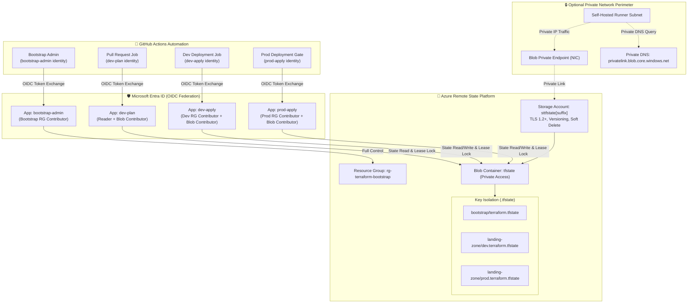
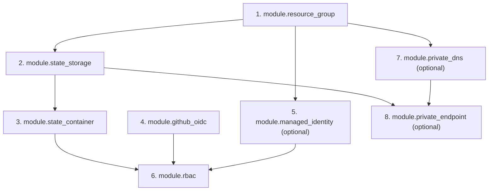

# Enterprise Architecture Specification

## 1. Overview & Architectural Vision

The **Azure Terraform Bootstrap Platform** establishes the core foundational infrastructure for automated, passwordless, enterprise-grade Infrastructure as Code (IaC) delivery across Microsoft Azure environments.

It addresses the fundamental requirements of secure cloud engineering:
1. **Isolated, Highly Resilient Remote State Management:** Centralized Azure Blob Storage with automated lease locking, soft delete protection, and blob versioning.
2. **Zero-Secret Identity Federation:** Microsoft Entra Workload Identity Federation (GitHub OIDC) eliminating long-lived service principal client secrets.
3. **Environment-Segregated Least-Privilege RBAC:** Independent identities for plan versus apply actions across Dev and Prod environments.
4. **Staged Network Perimeter Hardening:** Seamless transition path from initial public rollout over TLS 1.2+ to Private Endpoints and private DNS resolution for Azure-hosted self-hosted runners.

---

## 2. Target Architecture Diagram

---

## 3. Component Inventory & Responsibilities

| Component | Resource Type | Module | Primary Responsibility |
| :--- | :--- | :--- | :--- |
| **Bootstrap RG** | `azurerm_resource_group` | `modules/resource-group` | Administrative boundary holding state storage, identity registrations, and private network endpoints. |
| **State Storage** | `azurerm_storage_account` | `modules/state-storage` | Enterprise Blob storage with TLS 1.2, versioning, 30-day soft delete, and OAuth default authentication. |
| **State Container** | `azurerm_storage_container` | `modules/state-container` | Private container hosting state blobs partitioned by workload and environment keys. |
| **GitHub OIDC** | `azuread_application` / `federated_identity` | `modules/github-oidc` | Workload Identity Federation apps and federated credentials mapping GitHub branch and environment claims. |
| **Managed Identity** | `azurerm_user_assigned_identity` | `modules/managed-identities` | Native Azure User-Assigned Managed Identity for containerized or VM self-hosted runners. |
| **RBAC Engine** | `azurerm_role_assignment` | `modules/rbac` | Granular role assignments scoping state access to the container level and workload access to specific target RGs. |
| **Private Endpoint** | `azurerm_private_endpoint` | `modules/private-endpoint` | Private IP interface connecting internal Azure subnets to the storage account blob endpoint. |
| **Private DNS** | `azurerm_private_dns_zone` | `modules/private-dns` | Authoritative DNS resolution for `privatelink.blob.core.windows.net` across linked Virtual Networks. |

---

## 4. Terraform Dependency Flow

---

## 5. Security & Isolation Model

### Why Plan Identities Require Storage Blob Data Contributor
The Terraform `azurerm` backend uses Azure Blob Storage native lease locks to guarantee that no two processes mutate state concurrently. During `terraform plan`:
1. Terraform acquires an exclusive Blob Lease on the remote state blob.
2. Terraform refreshes state against Azure APIs.
3. Terraform writes lock metadata and releases the lease upon completion.

Because acquiring a blob lease and writing lock metadata are write-level storage operations, granting `Storage Blob Data Reader` alone causes `terraform plan` to fail with authorization errors (`AuthorizationPermissionMismatch`). Consequently, both Plan and Apply identities must hold `Storage Blob Data Contributor`, but access is strictly constrained to the **state container scope**, never the subscription or storage account root.

### Workload Scoping
While state container permissions are uniform, target cloud infrastructure permissions are strictly decoupled:
* **Plan Identity (`dev-plan` / `prod-plan`):** Holds Azure `Reader` on target subscription/resource groups. Cannot create, modify, or delete Azure resources.
* **Apply Identity (`dev-apply` / `prod-apply`):** Holds `Contributor` strictly scoped to target workload resource groups, bounded by GitHub Environment approvals.
