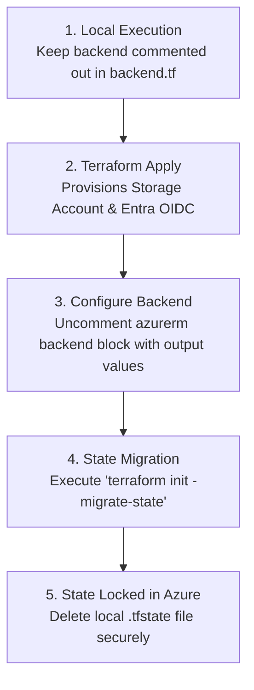

# AzureRM Remote Backend & State Engineering Guide

## 1. Remote Backend Architecture

Terraform stores the mapping between your configuration files and real-world Azure resources in a state file (`.tfstate`). Storing state centrally in Azure Blob Storage provides:
- **Centralized Synchronization:** Single source of truth across team members and CI/CD pipelines.
- **Automated Concurrency Protection:** Native Blob Lease locking prevents simultaneous write collisions.
- **Auditability & Recovery:** Immutable blob versions and 30-day soft-delete retention.

---

## 2. Decoupling Backend from Provider Configuration

A common source of confusion in Terraform is the strict distinction between **Provider** configuration and **Backend** configuration:

* **Provider (`provider "azurerm" {}`):** Tells Terraform how to authenticate when managing target infrastructure resources (`azurerm_virtual_network`, `azurerm_firewall`).
* **Backend (`backend "azurerm" {}`):** Tells Terraform how to read and write its own state file. It initializes *before* any provider blocks are parsed.

### Clean Partial Backend Configuration
Enterprise teams avoid hardcoding storage names and keys into source code by using partial backend definitions:

```terraform
terraform {
  required_version = ">= 1.9.0"

  backend "azurerm" {}
}
```

Dynamic values are passed during `terraform init` via a `.hcl` file or command-line arguments:

```bash
terraform init \
  -backend-config="resource_group_name=rg-terraform-bootstrap" \
  -backend-config="storage_account_name=sttfstateabc123" \
  -backend-config="container_name=tfstate" \
  -backend-config="key=landing-zone/dev.terraform.tfstate" \
  -backend-config="use_oidc=true"
```

---

## 3. Resolving the Bootstrap Chicken-and-Egg Problem

Terraform cannot store its state in an Azure Storage Account that has not yet been provisioned.



### Migration Execution
1. Deploy bootstrap infrastructure using local state:
   ```bash
   terraform init
   terraform apply
   ```
2. Retrieve the generated storage account name from outputs:
   ```bash
   terraform output storage_account_name
   ```
3. Update `backend.tf` with the storage account name and uncomment the block.
4. Execute state migration:
   ```bash
   terraform init -migrate-state
   ```
   Answer `yes` when prompted:
   ```text
   Do you want to copy existing state to the new backend?
     Pre-existing state was found while migrating the previous "local" backend to the
     newly configured "azurerm" backend. No existing state was found in the newly
     configured "azurerm" backend. Do you want to copy this state to the new "azurerm"
     backend? Enter "yes" to confirm and "no" to cancel.

     Enter a value: yes
   ```
5. Remove any local `.tfstate` backup files.

---

## 4. State Key Organization Hierarchy

To guarantee state isolation and prevent monolithic blast radiuses, downstream landing zones must use distinct state keys within the shared `tfstate` container:

```text
tfstate (Container)
│
├── bootstrap/
│   └── terraform.tfstate                     <-- This repository's infrastructure
│
├── core-governance/
│   └── management-groups.terraform.tfstate   <-- Policy & MG hierarchy
│
├── network-hub/
│   ├── hub-network.terraform.tfstate         <-- VNet Hub, Firewall, Bastion
│   └── dev-spoke.terraform.tfstate           <-- Dev workload spoke VNet
│
└── workloads/
    ├── dev-aks.terraform.tfstate             <-- AKS dev cluster
    └── prod-aks.terraform.tfstate            <-- AKS prod cluster
```

---

## 5. Blob Lease Locking Mechanics

When Terraform runs with the `azurerm` backend:
1. It requests an exclusive Blob Lease on `<workload>/<env>.terraform.tfstate` with a 60-second lease duration.
2. Azure Blob Storage returns a unique `Lease ID`.
3. If another pipeline attempts to run concurrently, it receives HTTP 412 (`There is currently a lease on the blob and no lease ID was specified in the request`).
4. Terraform renews the lease automatically every 15 seconds during long applies.
5. Upon completion or failure, Terraform releases the lease.

### Breaking a Stale Lease
If a CI runner terminates unexpectedly (e.g., hard kill):
```bash
az storage blob lease break \
  --account-name "<STORAGE_ACCOUNT_NAME>" \
  --container-name "tfstate" \
  --blob-name "landing-zone/dev.terraform.tfstate" \
  --auth-mode login
```

