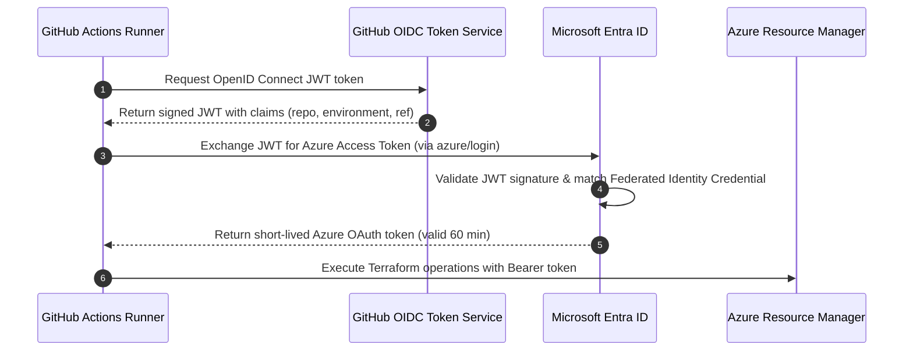

# Microsoft Entra Workload Identity Federation (GitHub OIDC) Setup Guide

## 1. How OIDC Token Exchange Works



---

## 2. Subject Claim Standards & Matrix

Microsoft Entra ID strictly validates the `sub` claim present in GitHub's signed token. This platform provisions federated credentials mapped to explicit deployment contexts:

| Identity Role | Subject Claim Format | Trigger Condition | Intended Scope |
| :--- | :--- | :--- | :--- |
| **Bootstrap Admin** | `repo:<org>/azure-terraform-bootstrap-oidc:ref:refs/heads/main` | Pushes to `main` in bootstrap repo | Full management of state storage & identity |
| **Dev Plan** | `repo:<org>/<repo>:environment:dev-plan` | Pull request validation or dev plan runs | State read & lease lock; Azure Reader |
| **Dev Apply** | `repo:<org>/<repo>:environment:dev-apply` | Direct development deploys | State read/write & lease lock; Dev RG Contributor |
| **Prod Plan** | `repo:<org>/<repo>:environment:prod-plan` | Release branch / production plan runs | State read & lease lock; Azure Reader |
| **Prod Apply** | `repo:<org>/<repo>:environment:prod-apply` | Approved production deployment jobs | State read/write & lease lock; Prod RG Contributor |
| **Legacy Branch** | `repo:<org>/<repo>:ref:refs/heads/main` | Backward compatibility fallback | Supported during phased migration |

---

## 3. GitHub Configuration Steps

### Step 1: Configure GitHub Environments
In each downstream repository (`Settings` > `Environments`), create:
1. `dev-plan`
2. `dev-apply`
3. `prod-plan`
4. `prod-apply` (Add **Required Reviewers** under Deployment Protection Rules)

### Step 2: Configure Environment Variables
Set the following variables (or secrets) in GitHub:

```bash
# Set at Repository or Environment level
AZURE_CLIENT_ID_PLAN   = "<CLIENT_ID_OF_DEV_PLAN_APP>"
AZURE_CLIENT_ID_APPLY  = "<CLIENT_ID_OF_DEV_APPLY_APP>"
AZURE_TENANT_ID        = "<MICROSOFT_ENTRA_TENANT_ID>"
AZURE_SUBSCRIPTION_ID  = "<TARGET_AZURE_SUBSCRIPTION_ID>"
```

### Step 3: GitHub Actions Login Action
Incorporate the official `azure/login` action into your pipeline:

```yaml
- name: Authenticate to Azure via OIDC
  uses: azure/login@v2
  with:
    client-id: ${{ vars.AZURE_CLIENT_ID_PLAN }}
    tenant-id: ${{ vars.AZURE_TENANT_ID }}
    subscription-id: ${{ vars.AZURE_SUBSCRIPTION_ID }}
```

---

## 4. Troubleshooting Common OIDC Errors

### Error: AADSTS70021: No matching federated identity record found
* **Root Cause:** The `subject` claim in the GitHub token does not match the `subject` string in Entra ID character-for-character.
* **Resolution:** Inspect the raw GitHub token claims. Ensure casing matches (`refs/heads/main` vs `refs/heads/Main`). Check whether the job specified `environment: dev-plan`. If a job specifies an environment, GitHub mints `repo:org/repo:environment:<env_name>`, NOT `repo:org/repo:ref:refs/heads/...`.

### Error: AADSTS700213: The audience 'api://AzureADTokenExchange' is invalid
* **Root Cause:** Audiences parameter was omitted or altered.
* **Resolution:** Ensure `audiences = ["api://AzureADTokenExchange"]`.

