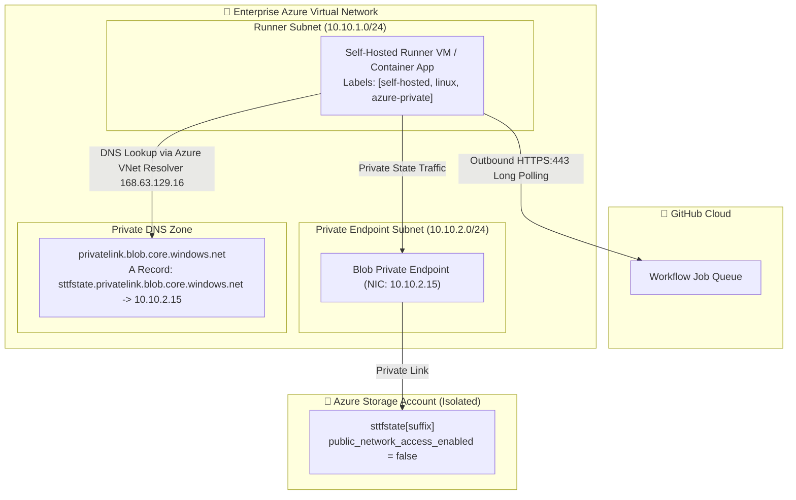

# Self-Hosted Azure Runner Architecture

## 1. Network Topology & Runner Placement

When remote state storage is secured behind Private Endpoints (`public_network_access_enabled = false`), standard GitHub-hosted runners (`ubuntu-latest`) can no longer reach Azure Blob Storage over the public internet.

To deploy infrastructure in this hardened zero-trust posture, self-hosted GitHub Actions runners must reside inside an Azure Virtual Network peered with or directly hosting the Blob Private Endpoint.



---

## 2. Network Connectivity Requirements

### Outbound Requirements
Self-hosted runners **never require inbound open ports**. Runners initiate outbound HTTPS (TCP 443) long-polling connections to GitHub:
- `github.com:443`
- `api.github.com:443`
- `*.actions.githubusercontent.com:443`
- `*.githubassets.com:443`

Outbound internet traffic can be routed through an Azure NAT Gateway or Azure Firewall with TLS inspection.

### Inbound Requirements
- **0 Inbound Ports Open:** No public IP addresses are assigned to runner network interfaces.

---

## 3. Runner Group Scoping & Security Boundaries

> [!WARNING]
> **Privilege Escalation Risk on Self-Hosted Runners:**
> Self-hosted runners maintain direct network access to private Azure control planes. Never allow untrusted pull requests from public fork repositories to execute on self-hosted private runners. A malicious PR could execute arbitrary bash commands inside your Azure virtual network.

### Governance Guardrails
1. **GitHub Runner Groups:** Place private runners in an Enterprise or Organization Runner Group restricted exclusively to selected, trusted repositories.
2. **Ephemeral Containers:** Use ephemeral runner containers (e.g. via Kubernetes Actions Runner Controller - ARC or Azure Container Apps jobs) so each job runs in a pristine environment and container instances terminate immediately after execution.
3. **Workflow Routing:** Direct workflows using specific labels:
   ```yaml
   runs-on: [self-hosted, linux, azure-private]
   ```
