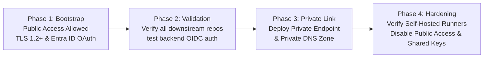

# Security & Governance Controls

## 1. Zero-Secret Philosophy

Traditional CI/CD pipelines store long-lived Service Principal client secrets (`ARM_CLIENT_SECRET`) within GitHub repository secrets. This architecture introduces severe vulnerabilities:
- **Exfiltration Risk:** Compromised workflows or debug jobs can expose secrets in logs.
- **Rotation Debt:** Failure to rotate secrets causes production outages upon expiration.
- **Lack of Governance:** Static secrets cannot enforce short-lived expiration windows or dynamic claims.

This platform operates strictly on **Microsoft Entra Workload Identity Federation (GitHub OIDC)**:
- No passwords, keys, or secrets are generated, stored, or managed in GitHub.
- GitHub Actions issues an OpenID Connect JWT token for each workflow execution.
- Azure Entra ID validates the token's cryptographic signature, issuer, audience, and subject claim before issuing a short-lived (60-minute maximum) Azure OAuth access token.

---

## 2. Storage Remote-State Security Controls

| Control | Implementation | Operational Justification |
| :--- | :--- | :--- |
| **Minimum TLS Version** | `TLS1_2` | Enforces modern cipher suites, mitigating downgrade attacks. |
| **HTTPS Only** | `https_traffic_only_enabled = true` | Denies cleartext HTTP requests. |
| **Public Nested Access** | `allow_nested_items_to_be_public = false` | Disallows anonymous blob access across all containers. |
| **Default to OAuth** | `default_to_oauth_authentication = true` | Sets Azure Portal data plane access to Entra ID by default. |
| **Blob Versioning** | `versioning_enabled = true` | Automatically creates immutable point-in-time snapshots on every state write. |
| **Blob Soft Delete** | `delete_retention_policy { days = 30 }` | Enables recovery from accidental state deletion for 30 days. |
| **Container Soft Delete** | `container_delete_retention_policy { days = 30 }` | Protects the entire state container from destructive deletion. |
| **Shared Key Auth** | `shared_access_key_enabled = var.shared_access_key_enabled` | Configurable toggle. Disabled in production once Entra ID auth is verified. |

---

## 3. Staged Network Migration Roadmap

To prevent production disruption, network hardening is executed in verified stages:



1. **Phase 1 (Creation):** `public_network_access_enabled = true`, `shared_access_key_enabled = true`. Allows initial local initialization and CI validation.
2. **Phase 2 (Entra Verification):** Migrate all repositories to use `use_oidc = true`. Verify zero reliance on storage account keys.
3. **Phase 3 (Private Link Deployment):** Enable `enable_private_networking = true` with target `virtual_network_id` and `subnet_id`.
4. **Phase 4 (Zero-Trust Enforcement):** Once self-hosted Azure runners resolve the blob endpoint privately, toggle:
   ```terraform
   public_network_access_enabled = false
   shared_access_key_enabled     = false
   ```

---

## 4. GitHub Actions Security Best Practices

### Untrusted Fork Pull Requests
Workflows accessing Azure OIDC must never execute on pull requests from fork repositories without review.
The `terraform-plan.yml` workflow enforces:
```yaml
if: github.event.pull_request.head.repo.full_name == github.repository || github.event_name == 'workflow_dispatch'
```
This blocks malicious fork contributors from extracting tokens or executing speculative plans against private Azure resources.

### Minimum Workflow Permissions
All workflows declare explicit top-level permissions following the principle of least privilege:
* `ci.yml`: `contents: read`
* `terraform-plan.yml`: `id-token: write`, `contents: read`, `pull-requests: write`
* `terraform-apply.yml`: `id-token: write`, `contents: read`

### Production Deployment Approval Gates
The `terraform-apply.yml` workflow binds execution to GitHub Environments (`prod-apply`). In GitHub Repository Settings, configure:
1. **Required Reviewers:** At least one senior platform engineer must manually approve deployment to production.
2. **Wait Timer:** Optional 5-minute cooling period before apply.
3. **Branch Protection:** Deployment restricted exclusively to commits originating from protected `main` branch.

